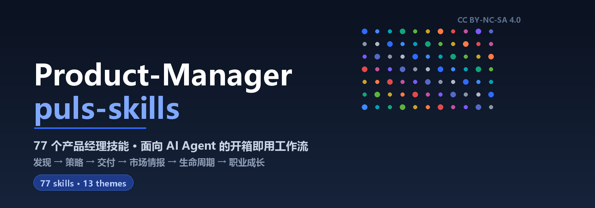
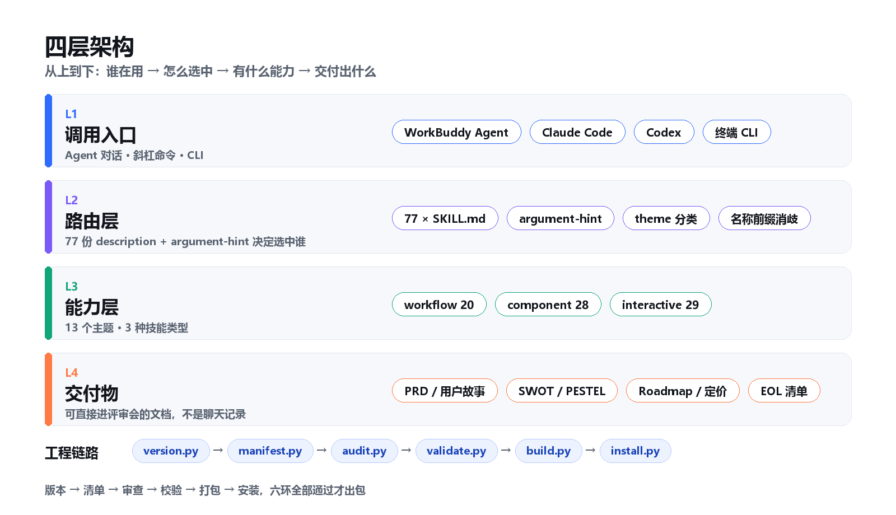
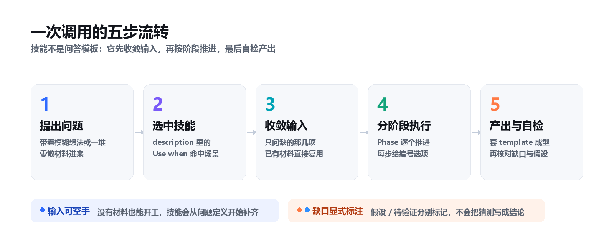
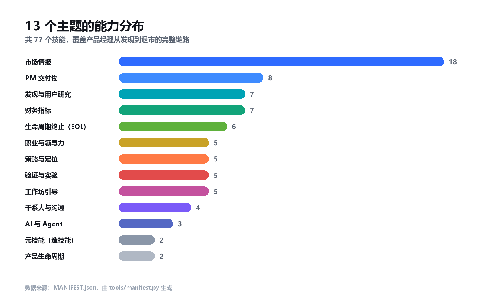
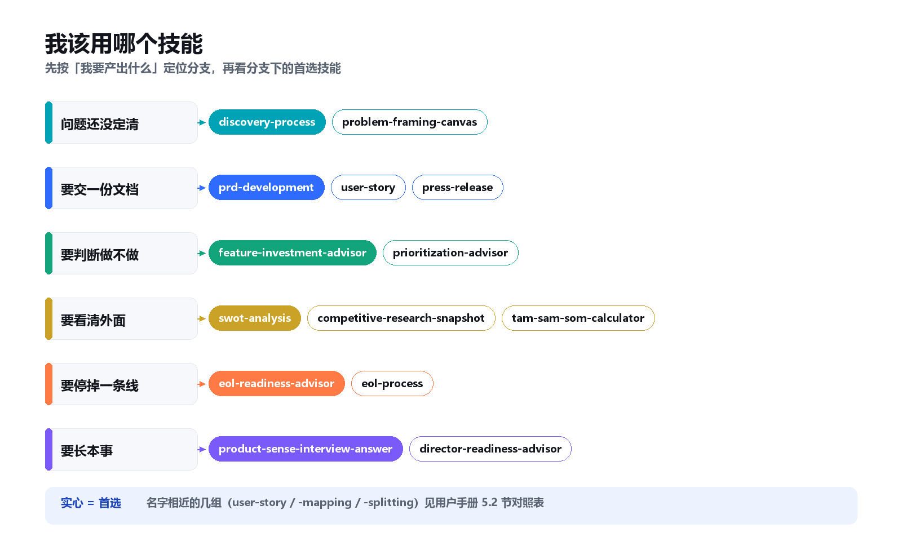
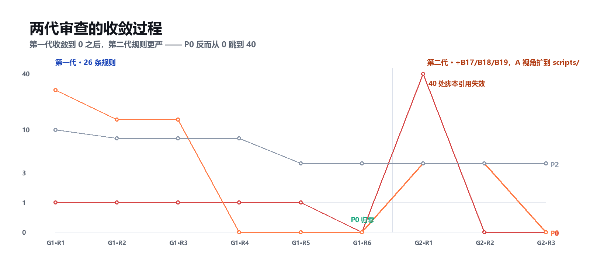
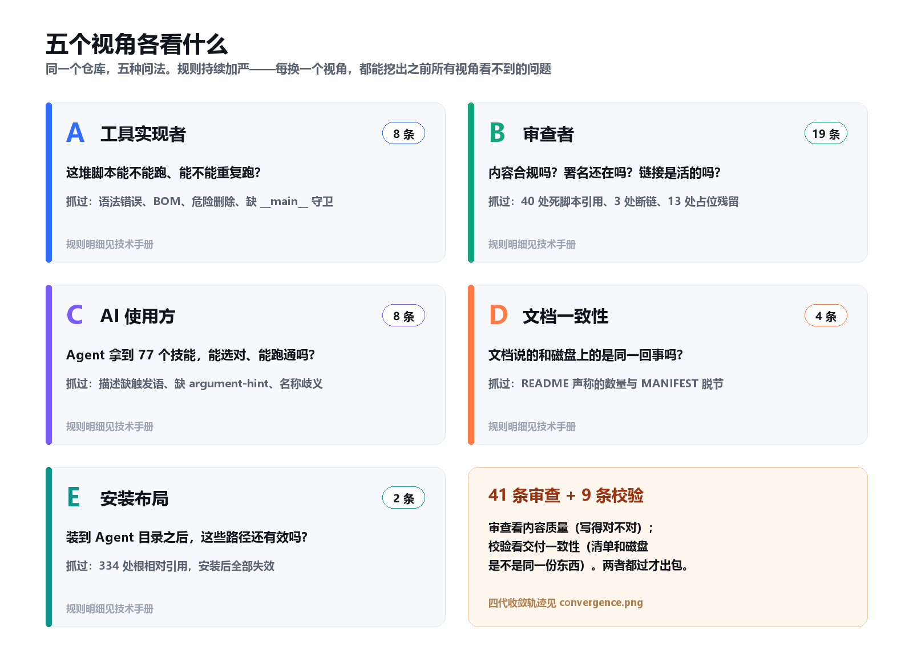

<div align="center">



<br>

**77 个产品经理技能，装进你的 AI Agent。**
从发现问题到产品退市，每一步都有可执行的方法论，而不是一段听起来很专业的聊天记录。

<br>

[](https://github.com/Asaceoo/Product-Manager-puls-skills/releases)
[](#技能速查)
[](#13-个主题)
[](LICENSE)

[快速开始](#30-秒上手) · [技能速查](#技能速查) · [用户手册](docs/USER-MANUAL.md) · [技术手册](docs/TECH-MANUAL.md)

</div>

---

## 这是什么

一套**面向 AI Agent 的产品经理方法论技能库**。每个技能是一份结构化的 `SKILL.md`：它规定这个任务该怎么问、按什么阶段推进、产出什么格式的文档、哪些地方必须标"假设"而不能写成结论。

它不是提示词模板合集。区别在于：提示词模板给你一段文字，技能库给 Agent 一套**受约束的流程**。

| | 普通提示词 | 本技能库 |
|---|---|---|
| 输入 | 你必须一次说清全部背景 | 空手也能开工，技能会逐项收敛 |
| 过程 | 一次生成，无法干预 | 分阶段推进，每步给编号选项 |
| 缺口 | 编造内容填空 | 显式标 `假设` / `待验证` |
| 产出 | 一段聊天记录 | 套 `template.md` 成型的文档 |
| 复用 | 每次重写提示词 | 斜杠命令 + `argument-hint` |

## 不是什么

- **不是原创方法论**。内容改编自 Dean Peters（Productside）的 [Product-Manager-Skills](https://github.com/deanpeters/Product-Manager-Skills)，本仓库是工程化再分发版，详见 [NOTICE](NOTICE)。
- **不是 SaaS 工具**。没有服务器、没有账号、不需要 API Key，纯本地 Markdown 文件。
- **不能替代你的判断**。技能会强制标注假设与待验证项，最终结论仍要你拿真实数据核对。

## 30 秒上手

```bash
git clone https://github.com/Asaceoo/Product-Manager-puls-skills.git
cd Product-Manager-puls-skills
python tools/install.py install
```

安装器会把 77 个技能复制到 `~/.workbuddy/skills/`，并写入安装记录，卸载时只删自己装的部分：

```bash
python tools/install.py list        # 看装了什么
python tools/install.py uninstall   # 按记录完整移除
```

<details>
<summary>只想装几个？用 <code>--only</code></summary>

```bash
python tools/install.py install --only prd-development,user-story,prioritization-advisor
python tools/install.py install --dry-run          # 先看计划，不落盘
python tools/install.py install --target D:/my/skills --force
```
</details>

装完后，在对话里直接说需求，Agent 会按 `description` 里的 `Use when …` 自动选中技能：

> 我需要给"自助开通工作区"这个功能写一份 PRD，手上有一份调研笔记和对应的 OKR。

## 四层架构



**L1 调用入口** —— WorkBuddy、Claude Code、Codex 或终端 CLI，任何能读 Markdown 的 Agent 都能用。
**L2 路由层** —— 77 份 `description` 决定选中谁；`argument-hint` 决定斜杠调用时提示什么参数。
**L3 能力层** —— 13 个主题，3 种技能类型（workflow 20 / component 28 / interactive 29）。
**L4 交付物** —— PRD、用户故事、SWOT、Roadmap、定价分析、EOL 清单。

底部是工程链路：版本号、清单、审查、校验、打包、安装六环闭合，任何一环失败都不出包。

## 一次调用怎么走



关键在第三步：**技能不要求你一次说清所有事**。它只问当前阶段缺的那几项，你已经给过的材料（笔记、Slack 记录、数据）会自动填进对应环节，不会重复问。

第二步的选中靠 `description` 里的触发语。这也是为什么本仓库对每个技能的描述都做了"`Use when …`"的强制要求——那是 Agent 唯一的路由依据。

## 13 个主题



| 主题 | 技能数 | 什么时候找它 |
|---|---:|---|
| 市场情报 | 18 | 调研竞品、看行业结构、算市场规模、盯竞品变化 |
| PM 交付物 | 8 | 写 PRD、拆用户故事、画故事地图、写新闻稿 |
| 财务指标 | 7 | 算 SaaS 指标、评定价、判断功能投资回报 |
| 发现与用户研究 | 7 | 跑发现周期、准备访谈、建 JTBD、画机会树 |
| 生命周期终止 | 6 | 决定是否退市、排期、写公告、内部赋能 |
| 职业与领导力 | 5 | PM 升总监、面试答题、30-60-90 天上任 |
| 工作坊引导 | 5 | 带定位工作坊、旅程地图工作坊、故事地图工作坊 |
| 验证与实验 | 5 | 设计廉价验证、选中该测什么、画 Lean UX Canvas |
| 策略与定位 | 5 | 定位陈述、优先级框架选型、跑策略会、排 Roadmap |
| 干系人与沟通 | 4 | 识别干系人、排优先级、拆解模糊需求 |
| AI 与 Agent | 3 | 设计多 Agent 工作流、评估 AI 就绪度、上下文工程 |
| 产品生命周期 | 2 | 判断处于哪个阶段、选延续还是替换 |
| 元技能 | 2 | 造新技能、把原始内容转成合规技能 |

## 我该用哪个技能



先按"我要产出什么"定位分支，再在分支里选。名字相近的几组见[用户手册 5.2 节](docs/USER-MANUAL.md#52-容易搞混的几组)。

## 20 个真实场景

每个场景给的是**技能链**——单独一个技能常常不够，真实工作都要串两三步。

| # | 情境 | 技能链 | 你会拿到 |
|---:|---|---|---|
| 1 | 运营群里甩来一句"做个积分系统，下周给方案" | `incoming-request-advisor` → `problem-framing-canvas` → `prioritization-advisor` | 一页纸：字面要求、真实意图、三个候选方案、该不该现在做的判断 |
| 2 | 要写 PRD，材料散在 8 份访谈、一份 OKR、37 条工单里 | `prd-development` | 十章 PRD + "送评审前必须补的三件事" |
| 3 | 竞品突然降价 30%，还加了两项服务 | `pricing-packaging-tracker` → `battle-card-builder` → `finance-based-pricing-advisor` | 可 diff 的定价时序 + 销售对战卡 + 跟进降价的影响区间 |
| 4 | 老款产品线销量从月 800 掉到 40，还有 6 家老客户在订 | `eol-readiness-advisor` → `eol-process` | go/no-go 结论 + 六个月退市计划（每项有责任人） |
| 5 | 新功能要投 3 个人 2 个月，老板问值不值 | `feature-investment-advisor` → `finance-metrics-quickref` | 收入影响 / 成本结构 / ROI 三件套，附敏感性区间 |
| 6 | 下周三带 8 个人开定位工作坊，只有 2 小时 | `positioning-workshop` → `workshop-facilitation` | 分钟级流程脚本：每步提问、产出物、跑偏处理 |
| 7 | 经销商反复说"你们的东西太贵"，但说不出贵在哪 | `voice-of-customer-miner` → `jobs-to-be-done` | 从真实原话提炼的未满足需求，而非"客户嫌贵"这种结论 |
| 8 | 老板要"看看 AI 能给我们干什么"，预算未知 | `ai-shaped-readiness-advisor` → `pol-probe-advisor` | 就绪度诊断 + 一个两周内、五千块能跑完的验证探针 |
| 9 | 下周面试产品经理，卡在产品感题上 | `product-sense-interview-answer` → `epic-hypothesis` | 结构化口述框架（澄清→分层→痛点→方案→取舍→指标） |
| 10 | 刚升总监，团队从 3 人变 12 人，前 90 天不知道抓什么 | `altitude-horizon-framework` → `executive-onboarding-playbook` | 30-60-90 天诊断路径 + 该放弃哪些 PM 视角的具体清单 |
| 11 | 要进新城市市场，但不确定先打哪个细分 | `market-landscape-scan` → `tam-sam-som-calculator` → `ansoff-matrix` | 市场分层 + 规模测算（含假设标注）+ 带风险排序的进入选项 |
| 12 | 客服工单里全是"不会用"，但产品经理认为是培训问题 | `discovery-process` → `problem-statement` → `lean-ux-canvas` | 把"不会用"拆成具体的卡点假设，配一个可测的最小实验 |
| 13 | 定价要从一次性买断改年费，怕老客户流失 | `finance-based-pricing-advisor` → `eol-stakeholder-sequence` | ARPU / 流失 / NRR / 回本期四维影响 + 该先跟谁谈 |
| 14 | 销售要一张"客户问我们和 A 公司比怎么样"的对战卡 | `battle-card-builder` | 一页卡，每条主张标证据等级，含"打不过的地方怎么说" |
| 15 | 做完 12 场用户访谈，素材堆在那不知道下一步 | `discovery-process` → `opportunity-solution-tree` | 机会→方案→实验的树状结构，每个机会挂证据引用 |
| 16 | 一个 Epic 太大，研发说"拆不动" | `epic-hypothesis` → `epic-breakdown-advisor` → `user-story-splitting` | 可验证假设 + 按九种模式拆出的两周内交付的故事 |
| 17 | 季度末要向上汇报产品健康度，只有一堆散数据 | `business-health-diagnostic` → `saas-revenue-growth-metrics` → `saas-economics-efficiency-metrics` | 四维体检（增长/留存/效率/资本）+ 三个必须回答的问题 |
| 18 | 要评估一个收购标的，手上只有公开信息 | `company-intel` → `company-research` → `swot-analysis` | 带出处的公司简报 + SWOT + S-O/W-T 交叉策略 |
| 19 | 供应商合同快到期，这条产品线还要不要续 | `lifecycle-play-advisor` → `product-lifecycle-plays` | 阶段诊断 + extend/replace/retire 三选一的理由与代价 |
| 20 | 想把 5 年质量管理经验做成一个可复用技能 | `pm-skill-creator` → `skill-authoring-workflow` → `scripts/test-a-skill.sh` | 合规的技能骨架（含触发语、输入定义、阶段流程），过审查 |

## 25 个可复制的用法

直接抄这些话去问，不用记技能名。右边是它会命中什么、给你什么。

| # | 你可以直接这样说 | 命中 | 你会得到 |
|---:|---|---|---|
| 1 | 「帮我把这个模糊需求问清楚：运营要个积分系统」 | `incoming-request-advisor` | 字面要求 vs 真实意图的拆解 |
| 2 | 「给自助开通工作区写一份 PRD，我有调研笔记和 OKR」 | `prd-development` | 十章 PRD，已给材料自动入章 |
| 3 | 「这个功能值不值得投 3 个人 2 个月」 | `feature-investment-advisor` | ROI 评估，含最坏情况 |
| 4 | 「帮我排一下这 7 个需求的优先级，团队 5 人，本季度有两个必做项」 | `prioritization-advisor` | 框架选型理由 + 排序 |
| 5 | 「写一条用户故事：新用户用 Google 登录，目标是免注册进应用」 | `user-story` | Mike Cohn 格式 + Gherkin 验收标准 |
| 6 | 「这条故事太大了，帮我拆成两周内能交付的」 | `user-story-splitting` | 按拆分模式切好的故事 |
| 7 | 「把这堆故事铺成一张发布切片地图」 | `user-story-mapping` | 活动→步骤→任务→切片的四层地图 |
| 8 | 「带团队画这张故事地图，6 个人，90 分钟」 | `user-story-mapping-workshop` | 分钟级引导脚本 |
| 9 | 「SWOT 我们最大的竞品，战略会要用」 | `swot-analysis` | 带出处的 SWOT + S-O/W-T 交叉 |
| 10 | 「读一下这个行业的五力结构，重点看新进入者」 | `porters-five-forces` | 每力附信号，不是教科书复述 |
| 11 | 「六类宏观因素扫一遍，我要判断明年要不要扩产」 | `pestel-analysis` | PESTEL + 对决策的影响判断 |
| 12 | 「帮我算 TAM/SAM/SOM，人口 540 万，ARPU 1000，SAM 30%，SOM 10%」 | `tam-sam-som-calculator` | 三步测算 + 假设清单（可直接跑 `scripts/market-sizing.py` 复核） |
| 13 | 「这三家竞品的定价建个能按季度 diff 的快照」 | `pricing-packaging-tracker` | 定价时间序列 |
| 14 | 「销售要 A 公司的对战卡，客户老说我们贵」 | `battle-card-builder` | 一页卡，含"打不过怎么说" |
| 15 | 「我们跟进降 20% 会怎样？ARPU 4800，年流失 18%，毛利 32%」 | `finance-based-pricing-advisor` | 五维影响区间 |
| 16 | 「给 SaaS 业务做个体检，我从增长、留存、效率、资本四块给数」 | `business-health-diagnostic` | 四维诊断 + 三个待答问题 |
| 17 | 「设计下周的 6 场用户访谈，对象是中小门窗经销商」 | `discovery-interview-prep` | 提纲 + 不该问的问题清单 |
| 18 | 「我怀疑问题不是功能少，是入口找不到，帮我框定」 | `problem-framing-canvas` | MITRE 画布，"以为的问题"vs"证据支持的问题" |
| 19 | 「把 12 场访谈整理成机会树」 | `opportunity-solution-tree` | 结果→机会→方案→实验 |
| 20 | 「我假设经销商愿意为月报付 200 元，两周五千块怎么验证」 | `pol-probe-advisor` | 探针方案：成本、周期、判定标准、失败后怎么办 |
| 21 | 「老产品线要不要退？月 800 掉到 40，还有 6 家老客户，2 家有年约」 | `eol-readiness-advisor` | go/no-go + 合同义务与迁移成本 |
| 22 | 「写退市公告，分三档：内部、大客户、公开」 | `eol-message` | 三档文案 |
| 23 | 「列一下这件事的干系人，然后排优先级」 | `stakeholder-identification` → `stakeholder-mapping` | 全集清单 + 双网格优先级 |
| 24 | 「练一道产品感题：设计给老人用的智能门锁 App，我背景是门业管培生」 | `product-sense-interview-answer` | 结构化口述稿，每步要真实经历支撑 |
| 25 | 「我想做一个"门业安装质量检查"技能，帮我结构化」 | `pm-skill-creator` | 合规骨架 + 过审查的命令 |

> 第 12 条的数值口径可以直接复核：
> ```bash
> python skills/tam-sam-som-calculator/scripts/market-sizing.py \
>   --population 5400000 --arpu 1000 --sam-share 30% --som-share 10%
> ```

## 技能速查

<details>
<summary><b>市场情报（18）</b> — 调研、竞品、行业结构</summary>

| 技能 | 类型 | 作用 |
|---|---|---|
| `swot-analysis` | workflow | 带证据出处的 SWOT，收尾给 S-O / W-T 交叉策略 |
| `porters-five-forces` | workflow | 五力模型读行业结构，每力附信号 |
| `pestel-analysis` | component | 六类宏观因素分析 |
| `pestel-delta-monitor` | workflow | 季度重扫 PESTEL，只报变化 |
| `market-landscape-scan` | workflow | 市场分层、玩家、替代品、空白区 |
| `competitive-analysis-process` | workflow | 六步编排完整竞品分析 |
| `competitive-research-snapshot` | workflow | 带引用的竞品快照 + 对比矩阵 |
| `competitive-intel-watch` | workflow | 对历史快照做增量监控 |
| `battle-card-builder` | workflow | 销售对战卡，每条主张标证据等级 |
| `company-research` | component | 公司研究简报：高管言论、产品策略、组织 |
| `company-intel` | workflow | 公司/行业/竞品组研究，七种分析透镜 |
| `ansoff-matrix` | workflow | 安索夫矩阵排增长选项，带风险分级 |
| `tam-sam-som-calculator` | interactive | TAM/SAM/SOM，显式列出假设与方法 |
| `voice-of-customer-miner` | workflow | 挖评论、应用商店、论坛里的未满足需求 |
| `pricing-packaging-tracker` | workflow | 竞品定价与包装的可 diff 时间序列 |
| `intelligence-collection-disciplines` | component | 八种情报收集学科（OSINT 到 MASINT） |
| `intel-discipline-advisor` | interactive | 把问题分流到合适的情报学科与节奏 |
| `autonomous-investigation` | workflow | 自主调研协议：搜索计划关卡、证据分级 |

</details>

<details>
<summary><b>PM 交付物（8）</b> — PRD、用户故事、故事地图</summary>

| 技能 | 类型 | 作用 |
|---|---|---|
| `prd-development` | workflow | 八阶段 PRD：从执行摘要到开放问题 |
| `epic-hypothesis` | component | 把 Epic 写成可验证假设 |
| `epic-breakdown-advisor` | interactive | Humanizing Work 九种拆分模式拆 Epic |
| `user-story` | component | Mike Cohn 格式 + Gherkin 验收标准 |
| `user-story-splitting` | component | 大故事拆小，按固定拆分模式 |
| `user-story-mapping` | component | 故事地图：活动 → 步骤 → 任务 → 发布切片 |
| `storyboard` | component | 六格分镜讲清用户从问题到解决 |
| `press-release` | component | 亚马逊式新闻稿，先定义客户价值 |

</details>

<details>
<summary><b>财务指标（7）</b> — SaaS 指标、定价、投资回报</summary>

| 技能 | 类型 | 作用 |
|---|---|---|
| `finance-metrics-quickref` | component | 快速查指标定义、公式、基准值 |
| `saas-revenue-growth-metrics` | component | 收入、留存、增长指标计算 |
| `saas-economics-efficiency-metrics` | component | 单位经济学与资本效率 |
| `business-health-diagnostic` | interactive | 四维体检：增长、留存、效率、资本 |
| `finance-based-pricing-advisor` | interactive | 定价变动评估：ARPU、转化、流失、NRR、回本期 |
| `feature-investment-advisor` | interactive | 功能投资回报：收入影响、成本结构、ROI |
| `acquisition-channel-advisor` | interactive | 获客渠道评估：单位经济学、客户质量、可扩展性 |

</details>

<details>
<summary><b>发现与用户研究（7）</b> — 发现周期、访谈、JTBD</summary>

| 技能 | 类型 | 作用 |
|---|---|---|
| `discovery-process` | workflow | 完整发现周期：问题假设到验证方案 |
| `discovery-interview-prep` | interactive | 访谈准备：目标、人群、约束、方法 |
| `jobs-to-be-done` | component | JTBD 格式梳理任务、痛点、收益 |
| `problem-framing-canvas` | interactive | MITRE 问题框定画布 |
| `problem-statement` | component | 问题陈述：谁被卡住、想做什么、卡在哪 |
| `proto-persona` | component | 从现有研究快速建原型画像 |
| `opportunity-solution-tree` | interactive | 机会解决方案树：结果 → 机会 → 方案 → 实验 |

</details>

<details>
<summary><b>生命周期终止（6）</b> — 退市决策与执行</summary>

| 技能 | 类型 | 作用 |
|---|---|---|
| `eol-process` | workflow | 端到端退市：决定、对齐、规划、准备、公告、收尾 |
| `eol-readiness-advisor` | interactive | 退市 go/no-go 评估，按规模匹配投入 |
| `eol-checklist` | component | 分阶段退市清单，每项有责任人 |
| `eol-message` | component | 分档退市公告：从简讯到完整分阶段沟通 |
| `eol-internal-enablement` | component | 支持 FAQ、销售话术、异议处理 |
| `eol-stakeholder-sequence` | component | 该跟谁谈、什么顺序、每场谈什么 |

</details>

<details>
<summary><b>职业与领导力（5）</b> — 晋升、面试、上任</summary>

| 技能 | 类型 | 作用 |
|---|---|---|
| `altitude-horizon-framework` | component | PM→总监的两个维度：高度与视野 |
| `director-readiness-advisor` | interactive | 总监过渡四阶段：准备、面试、落地、校准 |
| `vp-cpo-readiness-advisor` | interactive | VP/CPO 过渡四阶段 |
| `executive-onboarding-playbook` | workflow | 30-60-90 天上任诊断路径 |
| `product-sense-interview-answer` | component | 产品感面试答题结构：假设、分层、痛点、取舍 |

</details>

<details>
<summary><b>工作坊引导（5）</b> — 带会议、带共创</summary>

| 技能 | 类型 | 作用 |
|---|---|---|
| `workshop-facilitation` | interactive | 通用引导协议：一步步来、进度可见、编号选项 |
| `positioning-workshop` | interactive | 定位工作坊：目标客户、未满足需求、品类、收益 |
| `customer-journey-map` | component | 旅程地图：阶段、触点、行为、情绪、指标 |
| `customer-journey-mapping-workshop` | interactive | 旅程地图工作坊完整引导 |
| `user-story-mapping-workshop` | interactive | 故事地图工作坊完整引导 |

</details>

<details>
<summary><b>验证与实验（5）</b> — 低成本试错</summary>

| 技能 | 类型 | 作用 |
|---|---|---|
| `pol-probe` | component | Proof of Life 探针：用最小成本验证高风险假设 |
| `pol-probe-advisor` | interactive | 按假设、风险、资源选合适的 PoL 探针 |
| `derisk-measurement-advisor` | interactive | 决定该测什么、验证什么、盯什么 |
| `lean-ux-canvas` | interactive | Lean UX Canvas v2 引导 |
| `recommendation-canvas` | component | AI 产品想法评估：结果、假设、风险、定位 |

</details>

<details>
<summary><b>策略与定位（5）</b> — 定位、优先级、路线图</summary>

| 技能 | 类型 | 作用 |
|---|---|---|
| `positioning-statement` | component | Geoffrey Moore 式定位陈述 |
| `prioritization-advisor` | interactive | 按阶段、团队、干系人选优先级框架 |
| `product-strategy-session` | workflow | 端到端策略会：定位、发现、路线图 |
| `roadmap-planning` | workflow | 战略 Roadmap：优先级、Epic、对齐、排期 |
| `organic-growth-advisor` | interactive | 有机增长路径选择：新客群、新地域、新渠道 |

</details>

<details>
<summary><b>干系人与沟通（4）</b> · <b>AI 与 Agent（3）</b> · <b>产品生命周期（2）</b> · <b>元技能（2）</b></summary>

| 技能 | 类型 | 作用 |
|---|---|---|
| `stakeholder-identification` | component | 先列全干系人再谈沟通 |
| `stakeholder-mapping` | component | 双网格给干系人排优先级 |
| `stakeholder-engagement-advisor` | interactive | 针对单个干系人定沟通策略 |
| `incoming-request-advisor` | interactive | 拆解模糊需求，区分字面要求与真实意图 |
| `ai-shaped-readiness-advisor` | interactive | 判断你的工作方式是 AI-first 还是 AI-shaped |
| `context-engineering-advisor` | interactive | 诊断"堆上下文"与"上下文工程"的区别 |
| `agent-orchestration-advisor` | interactive | 多 Agent 工作流设计：边界、交接、监控 |
| `product-lifecycle-plays` | component | 判断生命周期阶段，选延续/替换/退出 |
| `lifecycle-play-advisor` | interactive | 按阶段推荐具体打法 |
| `pm-skill-creator` | interactive | 对话式设计新 PM 技能 |
| `skill-authoring-workflow` | workflow | 把原始内容转成合规可发布的技能 |

</details>

### 名字相近怎么选

`user-story` / `user-story-mapping` / `user-story-splitting` 三个只有前缀相同，用途完全不同：

| 你要做的事 | 用哪个 |
|---|---|
| 写一条带验收标准的用户故事 | `user-story` |
| 把一堆故事铺成发布切片的地图 | `user-story-mapping` |
| 一条故事太大，需要拆开 | `user-story-splitting` |
| 要带团队一起画这张地图 | `user-story-mapping-workshop` |

同理 `pol-probe` 是**单个探针的定义模板**，`pol-probe-advisor` 是**帮你选哪种探针**。

## 工程链路

第一代 26 条规则收敛到 0 之后，第二代把规则加严——P0 从 0 反弹到 40。





这套技能库不是"一堆 Markdown 扔上去"。六个脚本构成闭环，每次发布都要过全部门禁：

| 脚本 | 职责 | 关键约束 |
|---|---|---|
| `tools/version.py` | 版本号单一事实源 | 包与三份文档版本自动注入，禁止手改 |
| `tools/manifest.py` | 生成 `MANIFEST.json` | 记录每个技能的文件数与目录摘要 sha256 |
| `tools/audit.py` | 三视角对抗审查 | 工具实现者 / 审查者 / AI 使用方，P0+P1 必须为 0 |
| `tools/validate.py` | 清单约束兜底 | 清单与磁盘必须同一份东西，版本必须对齐 |
| `tools/build.py` | 打包流水线 | 版本 → 清单 → 审查 → 校验 → CHANGELOG → 打包 |
| `tools/install.py` | 可逆安装 | 只删自己装的，冲突默认跳过 |

```bash
python tools/build.py            # 完整发布：版本 patch+1，过门禁，出 zip
python tools/audit.py            # 单独跑审查
python tools/validate.py         # 单独跑校验
python tools/make_figures.py     # 重绘 README 配图
```

规则细节（A1–A8 / B1–B16 / C1–C8 / L1–L9）见 [技术手册](docs/TECH-MANUAL.md)。

## 目录结构

```
Product-Manager-puls-skills/
├── skills/                  77 个技能（SKILL.md + template.md + examples/）
├── catalog/                 全量索引（skills-index.yaml）
├── docs/
│   ├── USER-MANUAL.md       用户手册
│   ├── TECH-MANUAL.md       技术手册
│   └── images/              README 配图
├── tools/                   版本、清单、审查、校验、打包、安装、配图
├── MANIFEST.json            技能清单（自动生成）
├── versions.json            包与文档版本
├── VERSION                  包版本
├── CHANGELOG.md             发布记录（自动追加）
├── NOTICE                   上游署名与修改声明
└── LICENSE                  CC BY-NC-SA 4.0
```

## 与上游的差异

本仓库在上游基础上只做工程性修复，方法论内容未改动。完整清单见 [NOTICE](NOTICE)，摘要：

- 修复 3 处失效交叉引用（`stakeholder-map` → `stakeholder-mapping`）
- 清理 13 处未填充的创作期占位条目与 27 处失效的 `Suggested placement` 元信息
- 为 4 个技能补齐 `argument-hint`
- 新增工具链、清单、三份文档、CI 发布流程

原作者署名与其 `Provenance` 段落全部保留（45 个技能含 `Provenance` / `Adapted from`）。

## 许可证

**CC BY-NC-SA 4.0** — Attribution-NonCommercial-ShareAlike 4.0 International，全文见 [LICENSE](LICENSE)。

| 可以 | 不可以 |
|---|---|
| 个人学习、内部培训、非营利使用 | 售卖、作为付费产品/服务的一部分 |
| 修改后以同一许可证分发 | 去掉原作者署名 |
| 用于自己的产品决策 | 换成更宽松的许可证再分发 |

商业授权需联系原作者 Dean Peters。

---

<div align="center">

| 文档 | 版本 |
|---|---|
| 包版本 | <!--VER:package-->1.0.4<!--/VER--> |
| README | <!--VER:readme-->1.0.4<!--/VER--> |
| [用户手册](docs/USER-MANUAL.md) | <!--VER:user_manual-->1.0.4<!--/VER--> |
| [技术手册](docs/TECH-MANUAL.md) | <!--VER:tech_manual-->1.0.4<!--/VER--> |

<sub>内容改编自 <a href="https://github.com/deanpeters/Product-Manager-Skills">Dean Peters / Product-Manager-Skills</a>，以 CC BY-NC-SA 4.0 分发。</sub>

</div>
